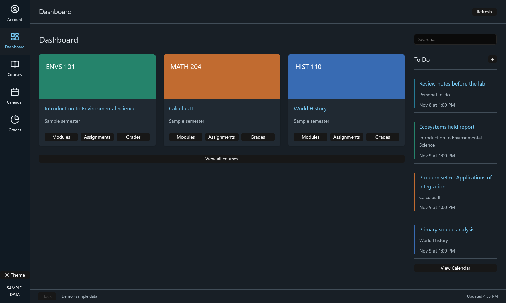
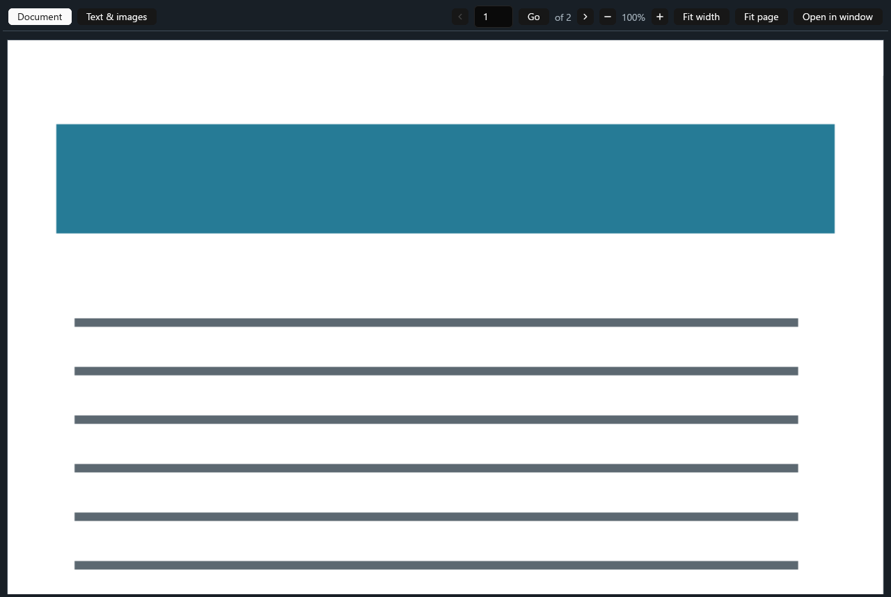

# Canvas Native

A native desktop client for Canvas LMS, built with Rust and
[GPUI](https://github.com/zed-industries/zed/tree/main/crates/gpui). It provides
Canvas-style dashboard and course navigation, module and assignment browsing,
grades, files, calendar/to-dos, and a continuous-scroll document reader with a
pure-Rust PDF renderer.

No webview is used for Canvas content, and no separate connector or external
PDF utility is required at runtime. Chrome/Chromium is used only for institutional
login.

| Dashboard | Document reader |
| --- | --- |
|  |  |

*Screenshots use the built-in sample account; no real account data is shown.
File actions are disabled there because the sample account has no Canvas session.*

## Features

- Familiar Canvas navigation: Dashboard, Courses, Calendar, Grades, Account, and
  per-course Home, Modules, Assignments, Grades, Files, and Syllabus.
- Virtualized module lists and on-demand loading for large courses.
- Continuous-scroll PDF reader rendered in-process by
  [hayro](https://github.com/LaurenzV/hayro); page navigation, jump-to-page,
  25–200% zoom, fit width, fit page, selectable text/images, Download,
  Save As…, and Open in Canvas.
- Document links open in a separate reader window, leaving the current list in
  place. Canvas HTML links to files are routed to the same native reader.
- Canvas-hosted external tools (LTI) launch through their Canvas module-item URL
  in the system browser, so tools such as Codon Learning use the browser's
  existing Canvas session.
- Institutional login through the platform browser; no Canvas API token needed.
- Light, dark, and system appearance.
- Writes require confirmation and are never retried automatically.

## Requirements

- Rust **1.92** or newer (`rust-version` in `Cargo.toml`).
- Chrome or Chromium for the institutional login flow.
- Linux: a Vulkan-capable GPU with X11 or Wayland, plus xkbcommon, fontconfig,
  FreeType, and the usual GPUI native build dependencies.
- macOS and Windows: the code has platform-independent document, networking and
  PDF paths, but only Linux has been fully exercised. See
  [Verification boundaries](#verification-boundaries).

## Build and run

```sh
git clone https://github.com/BlueCannonBall/canvas-native.git
cd canvas-native
cargo run --release
```

Enter your Canvas site under **Account**, connect, and complete the institutional
login in the browser window. Close that browser window to return to the client.
`CANVAS_URL` can set the initial Canvas origin.

The first optimized dependency build can take several minutes. The lockfile pins
compatible GPUI versions, and release builds reuse unchanged dependency code.

### Sample account

```sh
cargo run --release -- --demo
```

The sample account never contacts Canvas and never performs writes. Use
`CANVAS_NATIVE_DEMO_PAGE=document` to start on the sample document reader.

### Tests

```sh
cargo test --release
cargo clippy --all-targets -- -D warnings
cargo fmt --check
python3 scripts/test-isolated-x11.py   # includes the isolated X11 icon test
cargo run --release -- --check-backend  # offline operation catalog; no discovery
```

### Performance and renderer diagnostics

```sh
# No window is opened; DISPLAY and WAYLAND_DISPLAY are not needed.
env -u DISPLAY -u WAYLAND_DISPLAY target/release/canvas-native --renderer-info
```

This probes the same Blade device selection used by GPUI, not window presentation
or frame rate. A normal launch separately prints the actual window GPU/driver and
whether it is software-emulated. Those details are also shown under **Account →
Troubleshooting details**. A hardware probe succeeded locally with AMD Radeon 610M
/ RADV, `Software emulation: false`; do not assume that result applies to a launch
with different Vulkan/device environment overrides. GPUI's `ZED_DEVICE_ID`
override is honored by the probe. No driver/environment settings are rewritten.

Window titles are updated only when their content changes, not on every redraw.
On Linux, the native GPUI backend already exits after its last window closes. The
app does not synchronously call `quit` from a window-closed observer: GPUI 0.2.2's
X11 WM_DELETE_WINDOW callback still holds a mutable client borrow at that point.
Explicit Quit actions are scheduled on the foreground executor after the native
event handler returns. Interactive close/performance must be confirmed separately
on a permitted display; no input is sent to the shared `:0` display for testing.

### First-visit loading and scrolling

Read-only requests can run concurrently (up to four operations), while login,
configuration and writes remain serialized barriers. Navigation requests take
priority over background work; already-prefetching content is promoted rather
than fetched twice. Once a course is opened, the app warms only its Home,
Modules and Assignments metadata, with at most two background requests. It does
not preload every course, grade reports, or attachment bodies. Missing/partially embedded
module item lists load in parallel, with a four-module limit and stable ordering.
Assignment screens reuse the submission/grade included in their detail response
instead of adding another grade request. The separate single-assignment grade
operation also avoids fetching the entire course assignment list.
Account/session changes invalidate pending cache updates.

This reduces/hides first-visit waits, but network requests, login restoration and
initial text/image layout still take time. Course data remains an in-memory cache.
Live Canvas latency improvements have not been benchmarked here.

GPUI 0.2.2 supports pixel-precise scroll deltas. Its virtual list coalesces and
applies input directly; browser-like animated wheel easing is not automatic and
has not been added by this revision. Trackpad/native momentum behavior depends
on the input platform. Virtualization and animated scrolling are separate things.

## Using the client

- **Dashboard:** course cards open course Home pages. Cards use equal-width
  columns computed from the window width, so complete and partial rows stay
  aligned. Each card has direct Modules, Assignments, and Grades shortcuts in
  equal-width columns. Upcoming work appears in the To Do
  sidebar. Courses and upcoming work load automatically; there is no request form.
- **Courses:** the global button opens a Canvas-style course drawer without
  changing the current page. Select a course, use **All Courses** to browse current
  and past enrollments, or dismiss with Close, Escape, or a click outside. Within a course, use
  the familiar **Home, Modules, Assignments, Grades, Files, Syllabus** navigation.
- **Home:** follows Canvas’s configured landing page: Modules, Assignments,
  Syllabus, or the course’s actual front page. Module-based Home keeps the same
  virtualized list, search and collapse behavior as Modules. Activity-stream
  landing pages provide an explicit Open in Canvas action rather than a fake
  native feed. Native rich text does not reproduce every browser CSS layout.
- **Loading:** animated skeleton placeholders and a spinner identify the content
  being fetched. Failed loads offer a direct retry instead of an endless spinner.
- **Assignments:** search/filter the selected course’s assignments, open
  instructions, view due dates and submission status, read/download attachments,
  check scores, or add a reminder. Submission opens the assignment in Canvas;
  the reference API did not implement submitting work.
  Lock notices are converted from Canvas HTML into readable text, with entities
  decoded and hidden browser controls omitted. Locked instructions are not
  incorrectly described as missing. Page/file/module notices use the same handling.
- **Modules:** expandable modules contain named pages, assignments, and files.
  Selecting an item opens the corresponding native screen. Unsupported item
  types open their Canvas links rather than presenting a nonfunctional screen.
  External items use left-aligned links, not stretched buttons; text subheadings,
  indentation, completion, and lock/due metadata are preserved. The variable-height
  virtual list lays out visible/nearby rows only, retaining wrapped text rather
  than clipping everything to a fixed height. Search and collapse update cached
  row data; loading a long module index is prepared off the UI thread.
- **Grades:** cross-course grade summaries and per-course assignment tables,
  with current/final grades and submission state. Missing grades are not zero.
- **Calendar:** a month grid and agenda, previous/next month, Today, named course
  filtering, completion/activity filters, custom date ranges, and personal
  to-dos. Open a scheduled assignment or to-do directly from the calendar.
- **To-dos:** create/edit/delete personal or course-associated notes. Course
  associations and linked assignments/module items are selected by name.
  Changes require confirmation. A timeout/cancel never automatically retries a
  write and cannot undo one already accepted by Canvas.
- **Files/documents:** browse module files and assignment attachments, preview
  original resources, download or Save As, extract PDF/DOCX/text, continue long
  documents, view supported embedded PDF images, and save extracted images.
  Downloads offer Open and Show in Folder actions.
  Files and module links open a separate reader window automatically after
  metadata loads, leaving the list you came from in place. Canvas file links in
  pages, front pages, syllabi and assignment descriptions are collected into
  native reader actions instead of opening the system browser. A file with a
  readable resource opens in that window; the metadata card is only used when no
  resource is available. PDFs scroll continuously through rendered pages, with a
  compact toolbar for page navigation, jump, 25–200% zoom, fit width, fit page,
  Download, Save As…, and Open in Canvas. Pages
  are rendered on demand as they scroll into view, and the next pages are prepared
  in the background. Above 100% a page is wider than the reader column and scrolls
  sideways inside its own row; a page that fails to render offers a Retry.
  Supported images display natively. **Text & images** retains selectable PDF,
  DOCX and plain-text extraction, continuation and embedded image extraction.
  DOCX is a text preview, not a fully formatted Word page renderer.
- **External tools:** Canvas-hosted LTI module items open their Canvas module-item
  URL in the system browser. Using the module item rather than the tool's direct
  launch URL lets the browser's existing Canvas session sign the tool in. Opening
  a Canvas link minimizes the app so the system browser comes to the foreground.
- **Session persistence:** the app enables Chrome's session-restore preference so
  Canvas's session cookies survive app and browser restarts. If Canvas invalidates
  the session, the error banner offers **Sign in again** and opens the browser
  login flow directly.
- **Appearance:** choose System, Light, or Dark in Account, or use the sidebar’s
  Theme button to switch light/dark quickly. The preference is saved and System
  follows appearance changes. Native controls, HTML/text, tables, calendar,
  status colors, and app surfaces change together; the course-header colors stay
  recognizable. The sidebar brand uses a book icon instead of the letter C.

**No normal workflow asks for a course ID, assignment ID, file ID, page slug,
resource URI, or JSON arguments.** Those are carried internally from selected
courses and content. Raw tool names and response dumps are not part of the UI.

Files lists are limited to files exposed through modules and assignment
attachments, matching the reference API’s scope; this is not a full Canvas file
browser. HTML is rendered natively without JavaScript. This is not a complete
Canvas web renderer or full PDF editor. PDF annotations and text selection on the
rendered page itself are not implemented; use Text & images for selectable text.
Inbox, discussions editing, quiz-taking, and
assignment submission are not implemented by the reference and are not invented
as dead navigation links here.

### PDF preview and cache

PDF page previews are rasterized in-process by the pure-Rust **hayro** renderer.
No system PDF tools, webview or external executable is required, so previews work
on Linux, macOS and Windows. Text & images and Download remain available for
encrypted documents or pages the renderer cannot draw.

Opening a document downloads it once into a private, session-owned cache. Page
renders are reused. The reader keeps the visible pages and two ahead in flight,
and retains at most twelve decoded page images; older ones are re-requested from
the raster cache when they scroll back into view. Page aspect ratios come from
the rendered raster, so unrendered pages use a portrait placeholder until their
first render. Cache files are deleted on normal exit, successful login/session
refresh, or document Refresh; a forced crash may leave a private cache directory.
Preview files are not silently saved to Downloads. Explicit Download/Save As
still creates the user-requested persistent copy.

Previews accept files up to 64 MiB. PDF rasterization has bounded page
dimensions and output resolution. Large or encrypted documents can be downloaded
for an external reader. SVG previews reject external/local resource references
and DTDs; ordinary inline artwork is kept unchanged. Raster-image dimensions are
bounded before display. These are preview limits, not alterations to downloaded
originals.

## Implementation

- `src/app.rs`: route/controller state, automatic requests, per-request caches,
  named course context, to-do editor and downloads.
- `src/views.rs`: Canvas-style native screens; no schema-generated forms.
- `src/model.rs`: routes and selected-item request mapping, dates and grades.
- `src/module_list.rs`: cached module rows for variable-height virtualization.
- `src/appearance.rs`: persistent appearance selection and semantic palettes.
- `src/backend.rs`: bounded concurrent read worker, write/login barriers and settings.
- `src/canvas_api.rs`: direct authenticated REST requests, pagination, CSRF,
  session refresh, and app-owned browser authentication.
- `src/engine.rs`: in-process operation dispatch and document/image extraction.
- `src/document_preview.rs`: private source/raster cache and pure-Rust hayro PDF rendering.
- `src/native_results.rs`: small native result and parameter types; no router,
  schema-generation layer, or transport.
- `src/demo.rs`: isolated sample account, never a fallback for failed requests.

REST/session handling and extraction live in app-owned source files. There are
no path dependencies on another client or server. Profile/config handling,
cancellation cleanup, and dispatch are designed for a long-running GUI process.
HTTP GETs may refresh an expired session and retry once. Writes are not replayed.
Cookies and CSRF tokens are never displayed in the UI.

### Reference feature coverage

| Reference capability | Native interaction |
| --- | --- |
| `auth`, `refresh_auth` | Account sign-in / saved login |
| `course_list`, `course_info` | Dashboard / All Courses / course Home & Syllabus |
| `module_list`, `page_info` | Modules / select a named page |
| `assignment_list`, `assignment_info` | course Assignments / select an assignment |
| `grade_summary`, `course_grades`, `assignment_grade` | global Grades / course Grades / assignment grade panel |
| `dashboard_items` | Calendar / Agenda / Dashboard To Do |
| `planner_note_info` | select a calendar to-do |
| create/update/delete planner notes and custom-item aliases | Add To-do / Edit / Delete (same underlying actions) |
| `file_info` | select a named module file |
| download attachment and alias | Download / Save As |
| `attachment_text`, `attachment_image` | document reading / image buttons |
| original resource read, inline limit and automatic download | Preview original |

The operation catalog still covers all 24 reference tool names, including aliases,
without requiring users to learn those names.

## Linux desktop icon

The window supplies a multi-resolution chalkboard icon on X11, rasterized from
the embedded SVG (no runtime asset path or external converter is needed). Install the matching
application-menu/taskbar identity once, from the release executable:

```sh
target/release/canvas-native --install-desktop
```

This creates `edu.canvasnative.CanvasNative.desktop` under the user data
directory’s `applications/`, a matching PNG under
`icons/hicolor/256x256/apps/`, and full-color and symbolic SVGs under
`icons/hicolor/scalable/apps/` and `icons/hicolor/symbolic/apps/`.
The source is `assets/icons/edu.canvasnative.CanvasNative-chalkboard.svg`;
the book design remains a non-installed alternative.
It refuses to overwrite existing integration files, including older book icons.
Wayland uses that desktop identity to select its icon; X11 also gets a direct
`_NET_WM_ICON` property.
X11 icon setup matches the app’s process ID and exact WM_CLASS, including through
window-manager frames. It does not use GPUI 0.2.2’s unimplemented X11 raw-handle
method, which caused the initial icon change to panic during startup.

## Windows executable icon

GPUI’s Windows backend loads the window icon from resource ID 1 in the running
executable, and Explorer, the taskbar and Alt-Tab read the same resource. The
multi-size `assets/icons/edu.canvasnative.CanvasNative.ico` (16–256 px) is
generated from the same chalkboard SVG and embedded by `build.rs` through
`assets/icons/canvas-native.rc`; no runtime asset, converter or extra file is
shipped. Regenerate it with ImageMagick when the artwork changes:
`magick -background none assets/icons/edu.canvasnative.CanvasNative-chalkboard.svg -define icon:auto-resize=256,128,64,48,32,24,16 assets/icons/edu.canvasnative.CanvasNative.ico`.
This Windows-only build step has not been compiled or inspected on Windows, so
the embedded icon and the resulting taskbar appearance remain unverified. The
resource script itself compiles with `llvm-rc`, and the produced icon was
inspected at 256 and 32 px.

## Live read-only course checks

```sh
env -u DISPLAY -u WAYLAND_DISPLAY target/release/canvas-native --check-course-homes
```

This diagnostic uses the app’s own authentication/API, lists configured landing
page types, and reads front-page titles/body lengths without printing credentials
or HTML bodies. It was run successfully against the configured live account;
it does not launch the native UI or change course/account data.

## Verification boundaries

Verified for this revision: a real release build, all 110 non-ignored tests in
the release profile, formatting, Clippy with warnings denied, and
the complete 24-operation catalog. Shared-desktop automation has been removed; this project must
not send pointer or keyboard input to `:0` (see `AGENTS.md`).

The isolated 111-test run (which includes the X11 icon test) passed. The PDF
integration test now runs without Poppler and verifies real two-page hayro
raster output, page dimensions/center colors, source and raster reuse, and cache
deletion. Local HTTP tests verify parallel partial-module loading, targeted grade
fetching, attachment-size bounds and safe GET refresh. Tests also cover the
reader's page-width and prefetch-range rules, plus a headless GPUI render test
that opens a window, renders a six-page document at a scrolled position, sends a
wheel event and redraws. That test is what caught the reader's list-state
re-borrow panic; it uses the GPUI test platform and no display. These do not
constitute visual UI or live Canvas latency verification.
Additional tests cover Canvas landing-page selection, the front-page REST
endpoint, readable HTML lock notices, and window-icon pixels. The installed
desktop entry passed `desktop-file-validate`; its PNG was inspected directly.
The isolated X11 test creates unmapped test windows, verifies icon properties,
rejects other process/class identities, and checks reparenting. It requires Xvfb
but not Vulkan/DRI3. Use the script above to run all ignored tests safely; a bare
`--include-ignored` without an explicitly isolated display is intentionally refused.

Tests cover the app’s named navigation and selection mapping as well as adapted
REST, authentication policy, resource/file safety and document extraction tests.
They use generated documents and local fake HTTP/WebDriver endpoints, not the
real account. Demo mode provides distinct courses and assignments to check that
navigation preserves the selected course.

Live interactive institutional login, account writes, real downloads,
native save dialogs, scrolling frame rate and other operating systems require
separate verification. A simulated 401 at startup displayed the session-expired
banner and **Sign in again** launched the browser login; the Chrome profile
contains `session.restore_on_startup = 1`, but a complete sign-in/restart cycle
was not run because institutional credentials were not entered here.

The reader was exercised visually on a private headless display (weston's
headless backend with Xwayland, `DISPLAY=:1`), against the configured account in
read-only mode. One-page and two-page PDFs opened from the course Files list and
from module file rows into separate reader windows while the originating list
stayed in place. A Canvas page whose body was only a PDF link now renders a
native “File in this page” action; clicking it opened the 14-page syllabus in the
reader instead of the system browser. Pages were rasterized by hayro at fit
width; the reader scrolled from page 1 to page 14 and back, and page 1 rendered
again after its decoded image had been evicted. Fit page showed a whole page at
58%; wheel scrolling moved continuously into page 2; typing a page number and
pressing Go jumped to it; Download saved the PDF and showed the completion strip
with Open and Show in folder. A module ExternalTool (Codon Learning) now opens its
Canvas module-item URL instead of the direct tool launch URL. The reader's Open
in Canvas button, page links, and LTI module items all use the system browser. Text & images rendered
extracted text; both light and dark
appearance looked correct. The
global navigation's top book icon is gone. The dashboard grid was checked at
1500 and 1152 window widths: cards fill the available width in three equal
columns at 1500 and two at 1152, and a partial final row keeps the same card
width. The three shortcut buttons occupy equal thirds without clipping. Main and reader windows
are clamped to the display: on a 1280×720 display the main window opened at
1152×648 and the reader at 1000×576; at a 640×480 reader size the toolbar wrapped
to two rows instead of extending off-screen. Rounded corners use a shadow edge
with no stepped gray border ring. Plain Xvfb
has no DRI3, so Vulkan presentation fails there; the working recipe is
`WESTON_HEADLESS=1 weston --backend=headless --renderer=gl
--width=1800 --height=1100 --socket=wayland-99 --xwayland --no-config` and
running the app with `DISPLAY=:1`. The same display was used earlier to check
the loading spinner, dark-mode skeleton contrast, and attachment-row icon
alignment. Per-page horizontal panning above 100% and frame rate were not
measured in that environment. The Windows executable icon and the full app still
need a Windows build; hayro itself and its dependencies did compile for
`x86_64-pc-windows-msvc` in a standalone check.

## License

MIT. See [LICENSE](LICENSE).

Canvas is a trademark of Instructure, Inc. This project is not affiliated with
or endorsed by Instructure.

## Acknowledgements

- [GPUI](https://github.com/zed-industries/zed/tree/main/crates/gpui) and
  [gpui-component](https://github.com/longbridge/gpui-component) provide the
  native UI toolkit.
- [hayro](https://github.com/LaurenzV/hayro) provides pure-Rust PDF
  rasterization.
- The REST/session behavior and extraction paths were informed by the
  [canvas-mcp](https://github.com/UE2020/canvas-mcp) reference project. Canvas
  Native does not depend on its executable, settings, browser profile, or source
  tree at build or runtime.
